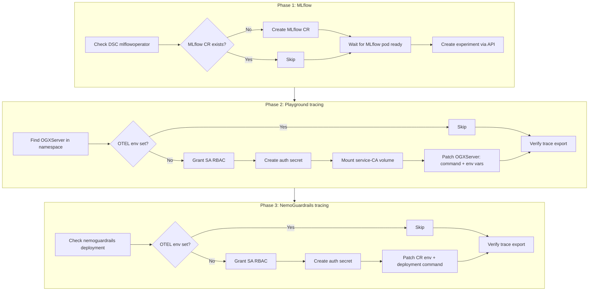

# MLflow Tracing for RHOAI GenAI Studio

## Overview

Red Hat OpenShift AI (RHOAI) GenAI Studio provides a Playground for interacting with
LLM models and optional NemoGuardrails for policy enforcement. However, **out of the
box there is no tracing** — Playground interactions and guardrail decisions are not
recorded anywhere for audit, debugging, or compliance.

This guide explains how `setup-mlflow-tracing.sh` wires OpenTelemetry tracing from
the Playground and NemoGuardrails into MLflow, giving you:

- Full input/output capture for every LLM call (prompts, completions, token counts)
- Guardrail evaluation traces showing which rails fired and whether they blocked
- A persistent audit trail in the MLflow Traces UI

### Architecture

```
┌─────────────────────────────────────────────────────────────────┐
│  RHOAI Dashboard (GenAI Studio)                                 │
│                                                                 │
│  User sends prompt in Playground                                │
│       │                                                         │
│       ├──► OGX Server (Llama Stack) ──► MaaS Model Backend      │
│       │         │                                               │
│       │         │  OTEL traces (openai-v2 instrumentation)      │
│       │         ▼                                               │
│       │    ┌─────────┐                                          │
│       │    │  MLflow  │  ◄── OTLP over HTTPS (with SA token)    │
│       │    │  Traces  │                                         │
│       │    └─────────┘                                          │
│       │         ▲                                               │
│       │         │  OTEL traces (built-in NemoGuardrails tracing)│
│       │         │                                               │
│       └──► NemoGuardrails ──► MaaS Model Backend (LLM judge)   │
│            (guardrail checks)                                   │
└─────────────────────────────────────────────────────────────────┘
```

### Setup Flow



**Two trace sources, one MLflow destination:**

| Source | What it traces | Service name |
|---|---|---|
| **Playground (OGX)** | LLM inference calls — input prompt, model response, token counts | `playground` |
| **NemoGuardrails** | Guardrail evaluations — which rails fired, LLM judge calls, block/allow | `nemoguardrails` |

### Interactive Animation

Open [docs/mlflow-tracing-flow.html](mlflow-tracing-flow.html) in a browser
for an animated walkthrough with **4 flows**:

1. **Full Setup (Phases 1–3)** — 23-step animated install sequence
2. **Trace Flow: Prompt Allowed** — runtime path when guardrails pass
3. **Trace Flow: Prompt Blocked** — runtime path when guardrails block
4. **Common Pitfalls** — 8 failure modes with fixes (SSL, headers, noise, etc.)

Click any node for a detailed tooltip with `oc` commands and config values.

## Prerequisites

- **RHOAI 3.5+** with GenAI Studio or MaaS deployed
- **`oc` CLI** logged in with cluster-admin or project-admin privileges
- A **project/namespace** (e.g. `demo`) with:
  - An OGXServer (Playground) already created and working
  - Optionally, NemoGuardrails deployed (for guardrail tracing)
- The **MLflow operator** enabled in the DataScienceCluster (`mlflowoperator: Managed`)

## Quick Start

```bash
# Default: configure everything in the 'demo' namespace
./scripts/setup-mlflow-tracing.sh --namespace demo

# Only set up MLflow (skip Playground and guardrails patching)
./scripts/setup-mlflow-tracing.sh --namespace demo --skip-playground --skip-guardrails

# Preview what would be done without making changes
./scripts/setup-mlflow-tracing.sh --namespace demo --dry-run
```

## What the Script Does

### Phase 1: MLflow Setup

MLflow is the trace storage backend. The script ensures it's running and has an
experiment ready to receive traces.

#### Step 1.1 — Verify the MLflow operator is enabled

```bash
oc get datasciencecluster default-dsc \
  -o jsonpath='{.spec.components.mlflowoperator.managementState}'
```

Must return `Managed`. If it returns `Removed`, the operator isn't installed.
You need to enable it in the RHOAI Dashboard under Settings > Cluster Settings,
or patch the DSC:

```bash
oc patch datasciencecluster default-dsc --type merge \
  -p '{"spec":{"components":{"mlflowoperator":{"managementState":"Managed"}}}}'
```

#### Step 1.2 — Wait for the MLflow CRD

After enabling the operator, the CRD `mlflows.mlflow.opendatahub.io` takes a few
seconds to appear. The script polls for up to 60 seconds.

#### Step 1.3 — Create the MLflow CR

The MLflow CR has a **mandatory singleton name**: it must be called `mlflow`.
Any other name is rejected with a validation error.

```yaml
apiVersion: mlflow.opendatahub.io/v1
kind: MLflow
metadata:
  name: mlflow          # mandatory — only this name is accepted
spec:
  backendStoreUri: "sqlite:////mlflow/mlflow.db"
  serveArtifacts: true
  artifactsDestination: "file:///mlflow/artifacts"
  storage:
    accessModes: ["ReadWriteOnce"]
    resources:
      requests:
        storage: 5Gi
  workspaceLabelSelector:
    matchLabels:
      kubernetes.io/metadata.name: demo    # <-- your namespace
```

The `workspaceLabelSelector` controls which namespaces can access this MLflow
instance. The script sets it to the target namespace.

**Why this matters:** MLflow 3.14 in RHOAI uses `--app-name=kubernetes-auth`, which
means every API request must carry a valid Kubernetes SA token. The workspace selector
determines which SAs are authorized.

#### Step 1.4 — Wait for the MLflow pod

```bash
oc rollout status deployment/mlflow -n redhat-ods-applications --timeout=120s
```

The MLflow deployment runs in `redhat-ods-applications` (not your project namespace).

#### Step 1.5 — Create the MLflow experiment

MLflow requires an experiment to store traces. The script creates one named
`guardrails-playground` via the MLflow API, using a temporary SA token for auth:

```bash
curl -sk -X POST \
  "https://mlflow.redhat-ods-applications.svc:8443/mlflow/api/2.0/mlflow/experiments/create" \
  -H "Authorization: Bearer <sa-token>" \
  -H "Content-Type: application/json" \
  -H "X-MLflow-Workspace: demo" \
  -d '{"name": "guardrails-playground"}'
```

The experiment ID (typically `1`) is used in the OTEL headers for all subsequent
trace exports.

---

### Phase 2: Playground (OGX) Tracing

The OGX Playground pod ships 25+ OpenTelemetry instrumentation packages but they
are **dormant by default** — no OTEL env vars are set, and the startup command
doesn't activate auto-instrumentation.

#### Step 2.1 — Grant the Playground SA access to MLflow

MLflow's `kubernetes-auth` validates SA tokens via the Kubernetes TokenReview API.
The SA needs the `edit` role in the namespace:

```bash
oc adm policy add-role-to-user edit \
  system:serviceaccount:demo:lsd-genai-playground-sa -n demo
```

**Why `edit`?** MLflow's kubernetes-auth plugin checks standard Kubernetes RBAC.
The `edit` ClusterRole (aggregated from `mlflow-operator-mlflow-edit`) grants the
permissions MLflow expects.

#### Step 2.2 — Create the auth secret

Every OTLP trace export to MLflow needs three headers:
- `Authorization: Bearer <token>` — Kubernetes SA token for auth
- `X-MLflow-Workspace: demo` — which workspace to store traces in
- `X-MLflow-Experiment-Id: 1` — which experiment to file them under

These are packed into a single secret and injected as the `OTEL_EXPORTER_OTLP_HEADERS`
env var:

```bash
oc create secret generic otel-mlflow-auth -n demo \
  --from-literal=header="Authorization=Bearer $(oc create token lsd-genai-playground-sa \
    -n demo --duration=8760h),X-MLflow-Workspace=demo,X-MLflow-Experiment-Id=1"
```

**Why a secret?** The OTEL SDK reads `OTEL_EXPORTER_OTLP_HEADERS` as a comma-separated
`key=value` string. Storing the full header (including the Bearer token) in a Kubernetes
secret and referencing it via `valueFrom.secretKeyRef` keeps the token out of the
OGXServer spec and shell history.

#### Step 2.3 — Mount the OpenShift service-CA certificate

MLflow's TLS certificate is signed by the OpenShift service-CA, which is **not**
in the RHEL system CA bundle (`/etc/pki/tls/certs/ca-bundle.crt`). Without the
correct CA, the OTEL exporter fails with:

```
SSL: CERTIFICATE_VERIFY_FAILED - self-signed certificate in certificate chain
```

The fix: mount the `config-service-cabundle` ConfigMap (auto-maintained by OpenShift
with the service-CA cert) as a volume:

```bash
oc patch deployment lsd-genai-playground -n demo --type json -p '[
  {"op": "add", "path": "/spec/template/spec/volumes/-",
   "value": {"name": "odh-ca-bundle", "configMap":
     {"name": "config-service-cabundle",
      "items": [{"key": "service-ca.crt", "path": "service-ca.crt"}]}}},
  {"op": "add", "path": "/spec/template/spec/containers/0/volumeMounts/-",
   "value": {"name": "odh-ca-bundle", "mountPath": "/etc/pki/tls/custom", "readOnly": true}}
]'
```

**Caveat:** The OGX pod uses a RHEL base image. The NemoGuardrails pod uses a Debian
base image with a different cert path (`/etc/ssl/certs/ca-certificates.crt`). The
NemoGuardrails pod already has a `ca-bundle-transfer` volume that combines system CAs
with the service-CA, so no extra volume is needed there.

#### Step 2.4 — Wrap the startup with `opentelemetry-instrument`

The OTEL env vars tell the SDK **where** to export, but they don't **initialize** the
SDK. Without activation, the TracerProvider is a no-op `ProxyTracerProvider` and no
traces are generated.

The `opentelemetry-instrument` CLI wrapper:
1. Sets up the TracerProvider with a BatchSpanProcessor and OTLPSpanExporter
2. Activates auto-instrumentation packages (e.g. `opentelemetry-instrumentation-openai-v2`)
3. Execs the actual server command

```bash
# Original command:
ogx run /etc/ogx/config.yaml --insecure

# Wrapped command:
opentelemetry-instrument ogx run /etc/ogx/config.yaml --insecure
```

This is patched via the OGXServer CR's `spec.workload.overrides.command`.

#### Step 2.5 — Set the OTEL env vars

The full set of env vars, with rationale:

| Env var | Value | Why |
|---|---|---|
| `OTEL_SERVICE_NAME` | `playground` | Identifies this service in MLflow traces |
| `OTEL_EXPORTER_OTLP_ENDPOINT` | `https://mlflow.redhat-ods-applications.svc:8443` | In-cluster MLflow OTLP endpoint |
| `OTEL_EXPORTER_OTLP_PROTOCOL` | `http/protobuf` | MLflow accepts OTLP over HTTP with protobuf encoding |
| `OTEL_EXPORTER_OTLP_HEADERS` | *(from secret)* | Auth token + workspace + experiment headers |
| `OTEL_EXPORTER_OTLP_CERTIFICATE` | `/etc/pki/tls/custom/service-ca.crt` | OpenShift service-CA for TLS verification |
| `OTEL_SEMCONV_STABILITY_OPT_IN` | `gen_ai_latest_experimental` | Unlocks GenAI semantic conventions (required for content capture) |
| `OTEL_INSTRUMENTATION_GENAI_CAPTURE_MESSAGE_CONTENT` | `span_only` | Records prompts and completions as span attributes |
| `OTEL_PYTHON_DISABLED_INSTRUMENTATIONS` | *(23 instrumentors)* | Disables noisy instrumentors, keeps only `openai-v2` and `fastapi` |
| `OTEL_TRACES_EXPORTER` | `otlp` | Export traces via OTLP |
| `OTEL_METRICS_EXPORTER` | `none` | MLflow doesn't accept OTLP metrics (avoids 404 errors) |
| `OTEL_LOGS_EXPORTER` | `none` | MLflow doesn't accept OTLP logs (avoids 404 errors) |

**Why disable 23 instrumentors?** The OGX pod ships instrumentation for httpx, sqlite3,
starlette, asyncio, jinja2, and many more. Without filtering, a single Playground
prompt generates dozens of spans for internal HTTP calls, DB queries, and template
renders. Only `openai-v2` (LLM calls) and `fastapi` (request lifecycle) are useful.

**Why `span_only` for content capture?** The `opentelemetry-instrumentation-openai-v2`
package supports three modes: `span_only`, `event_only`, and `span_and_event`. MLflow
reads content from **span attributes** (not OTEL events), so `span_only` is required.
This also needs `OTEL_SEMCONV_STABILITY_OPT_IN=gen_ai_latest_experimental` to unlock
the newer GenAI attribute names.

---

### Phase 3: NemoGuardrails Tracing

NemoGuardrails has its own built-in tracing system that creates spans for rail
evaluations and LLM judge calls. Like OGX, it needs the OTEL SDK initialized and
configured to export to MLflow.

#### Step 3.1 — Grant the NemoGuardrails SA access to MLflow

Same pattern as the Playground SA:

```bash
oc adm policy add-role-to-user edit \
  system:serviceaccount:demo:nemoguardrails-serviceaccount -n demo
```

#### Step 3.2 — Create the auth secret

```bash
oc create secret generic nemoguardrails-otel-auth -n demo \
  --from-literal=header="Authorization=Bearer $(oc create token \
    nemoguardrails-serviceaccount -n demo --duration=8760h),X-MLflow-Workspace=demo,X-MLflow-Experiment-Id=1"
```

#### Step 3.3 — Patch the NemoGuardrails CR env vars

The NemoGuardrails CRD supports `valueFrom.secretKeyRef` in its `spec.env` array.
The script patches the CR (not the deployment) so changes persist across operator
reconciliation:

```bash
oc patch nemoguardrails nemoguardrails -n demo --type json -p '[
  {"op": "replace", "path": "/spec/env", "value": [
    {"name": "OPENAI_API_KEY", "valueFrom": {"secretKeyRef": {"name": "nemoguardrails-api-key", "key": "key"}}},
    {"name": "OTEL_SERVICE_NAME", "value": "nemoguardrails"},
    {"name": "OTEL_EXPORTER_OTLP_ENDPOINT", "value": "https://mlflow.redhat-ods-applications.svc:8443"},
    {"name": "OTEL_EXPORTER_OTLP_PROTOCOL", "value": "http/protobuf"},
    {"name": "OTEL_EXPORTER_OTLP_HEADERS", "valueFrom": {"secretKeyRef": {"name": "nemoguardrails-otel-auth", "key": "header"}}},
    {"name": "OTEL_EXPORTER_OTLP_CERTIFICATE", "value": "/etc/ssl/certs/ca-certificates.crt"},
    {"name": "OTEL_TRACES_EXPORTER", "value": "otlp"},
    {"name": "OTEL_METRICS_EXPORTER", "value": "none"},
    {"name": "OTEL_LOGS_EXPORTER", "value": "none"},
    {"name": "OTEL_PYTHON_DISABLED_INSTRUMENTATIONS", "value": "asgi,fastapi,httpx"}
  ]}
]'
```

**Note on OPENAI_API_KEY:** The NemoGuardrails pod needs a MaaS API key to call the
model as a judge. The script preserves the existing key by storing it in a secret
(`nemoguardrails-api-key`) and referencing it via `secretKeyRef`.

**Note on cert path:** The NemoGuardrails pod uses a Debian-based image where the CA
bundle is at `/etc/ssl/certs/ca-certificates.crt`. A `ca-bundle-transfer` init
container already combines the system CAs with the OpenShift service-CA, so no extra
volume mount is needed (unlike the OGX pod).

#### Step 3.4 — Wrap the startup with `opentelemetry-instrument`

~~The NemoGuardrails CRD does **not** support command overrides.~~ **Updated approach:**
instead of patching the deployment command directly (which the TrustyAI operator
reverts on reconciliation), the script sets `PYTHONPATH` to the auto-instrumentation
`sitecustomize` directory:

```
PYTHONPATH=/app/.venv/lib64/python3.12/site-packages/opentelemetry/instrumentation/auto_instrumentation
```

**How this works:** Python loads `sitecustomize.py` from `PYTHONPATH` at interpreter
startup — before any application code runs. The OpenTelemetry `sitecustomize.py`:
1. Creates a real `TracerProvider` with `BatchSpanProcessor` + `OTLPSpanExporter`
2. Activates installed auto-instrumentation packages
3. The application starts with a fully initialized OTEL SDK

This is set via the NemoGuardrails CR's `spec.env`, so the operator **preserves it**
across reconciliations. No more command patches, no more operator reverts.

#### Step 3.5 — Enable tracing in the guardrail config

The `guardrail-placeholder` ConfigMap's `config.yaml` needs a `tracing` section:

```yaml
tracing:
  enabled: true
  enable_content_capture: true
  adapters:
    - name: OpenTelemetry
```

This tells NemoGuardrails to generate trace spans for rail evaluations and pipe them
through the OpenTelemetry adapter (which uses the SDK configured by the env vars above).

---

## Understanding the Traces

### Playground traces (service: `playground`)

Each LLM call creates a trace with these key attributes:

| Attribute | Example | Meaning |
|---|---|---|
| `gen_ai.operation.name` | `chat` | Type of LLM operation |
| `gen_ai.request.model` | `publishers/llm/models/gpt-oss-20b` | Which model was called |
| `gen_ai.input_messages` | *(JSON)* | The user's prompt (with content capture) |
| `gen_ai.output_messages` | *(JSON)* | The model's response (with content capture) |
| `gen_ai.usage.input_tokens` | `42` | Prompt token count |
| `gen_ai.usage.output_tokens` | `156` | Completion token count |

In MLflow, click a trace and open the **Chat** tab to see the full conversation.

### NemoGuardrails traces (service: `nemoguardrails`)

Each guardrail evaluation creates a trace. The key span is the **LLM judge call**:

| Attribute | Example | Meaning |
|---|---|---|
| `gen_ai.operation.name` | `self_check_input` | Which rail was evaluated |
| `gen_ai.request.model` | `publishers/llm/models/gpt-oss-20b` | Judge model |
| `gen_ai.usage.input_tokens` | `415` | Tokens used by the judge prompt |
| `gen_ai.usage.output_tokens` | `145` | Judge response tokens |

### How to tell blocked vs. allowed

| Scenario | What you see in MLflow |
|---|---|
| **Input blocked** | Only a `self_check_input` trace from NemoGuardrails, no `self_check_output` |
| **Input allowed, output blocked** | Both `self_check_input` and `self_check_output` traces |
| **Fully allowed** | Both `self_check_input` and `self_check_output` traces, plus the Playground LLM call |
| **Guardrails off** | Only Playground LLM call traces, no NemoGuardrails traces |

---

## Key Design Decisions

### Why `opentelemetry-instrument` for OGX but `PYTHONPATH` for NemoGuardrails?

The OTEL env vars (`OTEL_EXPORTER_OTLP_ENDPOINT`, etc.) configure the SDK **if it's
initialized**, but they don't initialize it. Without activation, the Python process
has a no-op `ProxyTracerProvider` — all span creation is silently discarded.

**OGX Playground:** The OGXServer CRD supports `spec.workload.overrides.command`, so
the `opentelemetry-instrument` wrapper is set via the CR and the operator preserves it:

```bash
# Original command:
ogx run /etc/ogx/config.yaml --insecure

# Wrapped command (set via CR — operator-safe):
opentelemetry-instrument ogx run /etc/ogx/config.yaml --insecure
```

**NemoGuardrails:** The NemoGuardrails CRD does **not** support command overrides.
Patching the deployment directly gets reverted by the TrustyAI operator on
reconciliation. Instead, the script sets `PYTHONPATH` via the CR's `spec.env`:

```
PYTHONPATH=/app/.venv/lib64/python3.12/site-packages/opentelemetry/instrumentation/auto_instrumentation
```

Python loads `sitecustomize.py` from `PYTHONPATH` at interpreter startup — the same
initialization that `opentelemetry-instrument` performs, but via an env var that the
operator preserves. No command patches, no operator reverts.

### Why disable most instrumentors?

The OGX pod ships 25 auto-instrumentation packages (httpx, sqlite3, starlette,
asyncio, jinja2, redis, etc.). A single Playground prompt triggers internal HTTP calls,
database queries, and template renders — each generating OTEL spans. This creates
dozens of noisy traces per user interaction.

Only two instrumentors produce useful traces:
- `openai-v2` — traces the actual LLM API call with model, tokens, and content
- `fastapi` — traces the HTTP request lifecycle (one parent span per interaction)

### Why `span_only` for content capture?

The `opentelemetry-instrumentation-openai-v2` supports three content modes:
- `span_only` — records messages as span attributes
- `event_only` — records messages as OTEL events
- `span_and_event` — both

MLflow reads content from **span attributes**, not OTEL events. Using `event_only`
results in an empty Chat view in MLflow. `span_only` is the correct choice.

This also requires `OTEL_SEMCONV_STABILITY_OPT_IN=gen_ai_latest_experimental` to
unlock the newer GenAI semantic convention attribute names that include message content.

### Why mount the service-CA separately for OGX?

OpenShift services use TLS certificates signed by the cluster's service-CA. This CA
is **not** included in the RHEL system CA bundle. The OGX pod (RHEL-based) needs the
`config-service-cabundle` ConfigMap mounted as a volume.

The NemoGuardrails pod (Debian-based) already has a `ca-bundle-transfer` init container
that combines system CAs with the service-CA into `/etc/ssl/certs/ca-certificates.crt`,
so no extra volume is needed.

### Why workspace and experiment headers?

MLflow 3.14 in RHOAI runs with `--enable-workspaces` and `--app-name=kubernetes-auth`.
Every API request (including OTLP trace ingestion) requires:
- `X-MLflow-Workspace` — which workspace to store the data in
- `X-MLflow-Experiment-Id` — which experiment to file traces under

Without these headers, MLflow returns `400 Bad Request: Workspace context is required`.

---

## Troubleshooting

### 401 Unauthorized on trace export

**Symptom:** MLflow logs show `POST /v1/traces HTTP/1.1" 401 Unauthorized`

**Causes:**
1. SA token expired — recreate the auth secret
2. SA lacks `edit` role — run `oc adm policy add-role-to-user edit system:serviceaccount:<ns>:<sa> -n <ns>`
3. Wrong SA token in secret — verify with `oc get secret otel-mlflow-auth -n demo -o jsonpath='{.data.header}' | base64 -d | head -c 50`

```bash
# Diagnose
oc logs -n redhat-ods-applications deployment/mlflow -c mlflow --tail=20 | grep 401
```

### SSL certificate errors

**Symptom:** Pod logs show `CERTIFICATE_VERIFY_FAILED` or `NO_CERTIFICATE_OR_CRL_FOUND`

**Causes:**
1. Service-CA volume not mounted (OGX) — check `oc get deployment lsd-genai-playground -n demo -o jsonpath='{.spec.template.spec.volumes[*].name}'`
2. Wrong cert file path — OGX uses `/etc/pki/tls/custom/service-ca.crt`, NemoGuardrails uses `/etc/ssl/certs/ca-certificates.crt`
3. Empty cert file — the `odh-ca-bundle.crt` key in `odh-trusted-ca-bundle` is empty; use `ca-bundle.crt` or `config-service-cabundle`

```bash
# Verify cert is mounted and non-empty
oc exec deployment/lsd-genai-playground -n demo -- wc -l /etc/pki/tls/custom/service-ca.crt
```

### 400 Bad Request on trace export

**Symptom:** MLflow logs show `POST /v1/traces HTTP/1.1" 400 Bad Request`

**Cause:** Missing `X-MLflow-Workspace` or `X-MLflow-Experiment-Id` headers.

```bash
# Check the secret has all three headers
oc get secret otel-mlflow-auth -n demo -o jsonpath='{.data.header}' | base64 -d
# Should show: Authorization=Bearer <token>,X-MLflow-Workspace=demo,X-MLflow-Experiment-Id=1
```

### Empty Chat view in MLflow

**Symptom:** Traces appear but clicking one shows no messages in the Chat tab.

**Cause:** Content capture not configured. Requires **both**:
- `OTEL_SEMCONV_STABILITY_OPT_IN=gen_ai_latest_experimental`
- `OTEL_INSTRUMENTATION_GENAI_CAPTURE_MESSAGE_CONTENT=span_only`

```bash
# Verify env vars
oc get deployment lsd-genai-playground -n demo \
  -o jsonpath='{range .spec.template.spec.containers[0].env[*]}{.name}={.value}{"\n"}{end}' \
  | grep -E 'SEMCONV|CAPTURE'
```

### Too many noisy traces

**Symptom:** Dozens of traces per prompt (HTTP calls, DB queries, template renders).

**Cause:** `OTEL_PYTHON_DISABLED_INSTRUMENTATIONS` not set or incomplete.

```bash
# Check disabled instrumentors
oc exec deployment/lsd-genai-playground -n demo -- sh -c 'echo $OTEL_PYTHON_DISABLED_INSTRUMENTATIONS'
```

### NemoGuardrails traces stop appearing

**Symptom:** Guardrail traces worked, then stopped after a while.

**Cause (old approach):** Previously this was caused by the TrustyAI operator
reverting a direct deployment command patch. The updated approach uses `PYTHONPATH`
set via the CR's `spec.env`, which the operator preserves.

**If it still happens:** Verify the `PYTHONPATH` env var is set:

```bash
oc exec deployment/nemoguardrails -n demo -c nemo-guardrails -- \
  python3 -c "from opentelemetry import trace; print(type(trace.get_tracer_provider()).__name__)"
# Should print: TracerProvider (not ProxyTracerProvider)
```

If it prints `ProxyTracerProvider`, re-run the script:

```bash
./scripts/setup-mlflow-tracing.sh --skip-mlflow --skip-playground
```

---

## Cleanup

To remove all tracing configuration:

```bash
# Remove Playground OTEL env vars (re-patch OGXServer without OTEL vars)
# Remove auth secrets
oc delete secret otel-mlflow-auth nemoguardrails-otel-auth -n demo

# Remove SA role bindings
oc adm policy remove-role-from-user edit system:serviceaccount:demo:lsd-genai-playground-sa -n demo
oc adm policy remove-role-from-user edit system:serviceaccount:demo:nemoguardrails-serviceaccount -n demo

# Remove MLflow experiment (optional)
# Traces are retained in MLflow until the experiment is deleted via the UI

# Remove MLflow CR (removes the entire MLflow instance)
oc delete mlflow mlflow
```
